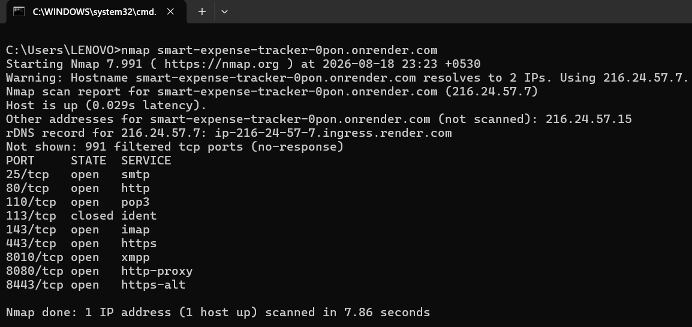
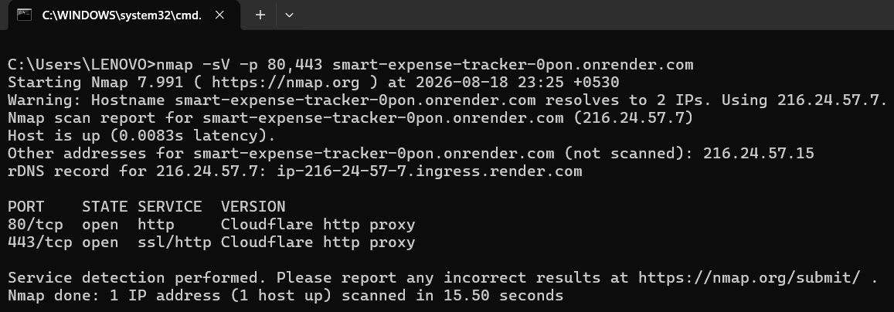
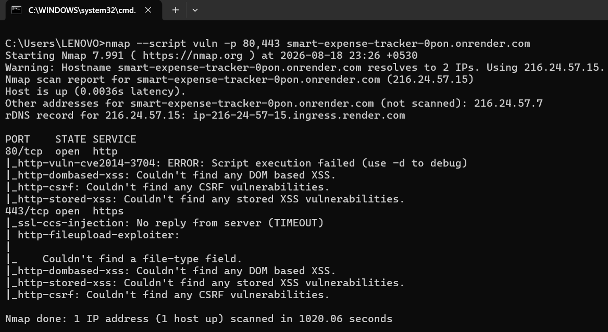
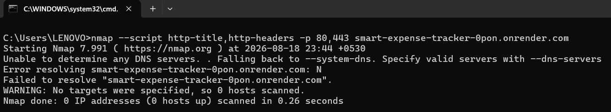
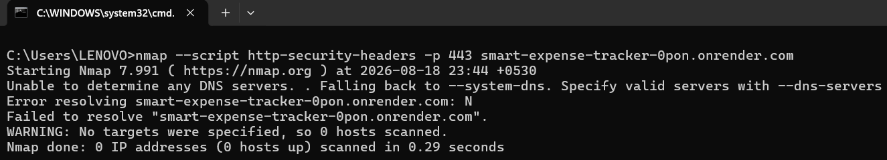

# 🔐 Reconnaissance & Vulnerability Scanning – Smart Expense Tracker

<div align="center">


</div>

---

## 📌 Overview

This repository documents the reconnaissance and vulnerability assessment performed on the **Smart Expense Tracker** web application as part of the **InternSpark Cybersecurity Internship Program — Task 1**.

The assessment used Nmap to perform port scanning, service detection, vulnerability script checks, HTTP header analysis, and security-header inspection on an authorized deployment.

The objective was to identify observable security weaknesses, document scan results, understand potential risks, and recommend appropriate remediation measures.

---

## 🎯 Objective

The primary objectives of this assessment were:

- Perform network reconnaissance and TCP port enumeration.
- Identify observable services on the target host.
- Perform automated vulnerability checks using Nmap NSE scripts.
- Inspect HTTP response headers and security-header configuration.
- Document potential security risks and scan limitations.
- Recommend remediation measures based on the observed results.

---

## 🌐 Target Application

### Smart Expense Tracker

A web-based expense management application developed using Python and Flask, with SQLite as its database, and deployed on Render.

**Target URL:**

```text
https://smart-expense-tracker-0pon.onrender.com/login
```

**Authorization:** The assessment was performed on my own deployed application with authorization to conduct the testing.

---

## 🛠️ Tools & Technologies Used

| Tool / Technology | Purpose |
|---|---|
| Nmap 7.99.1 | Port scanning and reconnaissance |
| Nmap Service Detection (`-sV`) | Service identification on selected ports |
| Nmap NSE Scripts | Automated vulnerability and HTTP security checks |
| Windows Command Prompt | Executing scan commands |
| Python / Flask | Application technology |
| SQLite | Application database technology |
| Render | Application hosting |
| Cloudflare | Proxy/CDN layer observed during scanning |
| GitHub | Repository hosting and documentation |

**Note:** Nikto was not successfully installed or used. No Nikto or OpenVAS results are claimed in this assessment.

---

## 🔎 Assessment Scope

The assessment covered:

- TCP port enumeration of the target hostname.
- Service/version detection on ports 80 and 443.
- Nmap vulnerability script checks on ports 80 and 443.
- HTTP title and response-header inspection.
- HTTPS security-header inspection, including HSTS.

The assessment did not include:

- Destructive denial-of-service testing.
- Confirmed exploitation of vulnerabilities.
- Authentication bypass attempts.
- A complete source-code security audit.
- A comprehensive test of every application endpoint.

The target is hosted on Render and was observed behind Cloudflare. Therefore, some scan results may describe the hosting or proxy infrastructure rather than the Flask application itself.

---

## 📋 Assessment Methodology

The following steps were performed:

1. Confirmed the authorized target hostname.
2. Performed a basic Nmap port scan.
3. Detected services on HTTP and HTTPS ports.
4. Ran Nmap vulnerability NSE scripts.
5. Inspected HTTP titles and response headers.
6. Checked the HTTPS endpoint for security headers.
7. Reviewed scan output and documented findings and limitations.
8. Prepared recommendations based on the observed evidence.

---

## ⚙️ Commands Executed

### 1. Basic Port Scan

```bash
nmap smart-expense-tracker-0pon.onrender.com
```

### 2. Service and Version Detection

```bash
nmap -sV -p 80,443 smart-expense-tracker-0pon.onrender.com
```

### 3. Vulnerability Script Scan

```bash
nmap --script vuln -p 80,443 smart-expense-tracker-0pon.onrender.com
```

### 4. HTTP Title and Header Inspection

```bash
nmap --script http-title,http-headers -p 80,443 smart-expense-tracker-0pon.onrender.com
```

### 5. HTTP Security Header Inspection

```bash
nmap --script http-security-headers -p 443 smart-expense-tracker-0pon.onrender.com
```

---

## ⚠️ Findings Summary

| Finding / Observation | Assessment |
|---|---|
| Multiple TCP ports observed | Infrastructure-level observation; ownership requires verification |
| Cloudflare proxy detected | Infrastructure identification |
| Backend technology information in response header | Potential information disclosure |
| HSTS not configured at scanned HTTPS endpoint | Security-header configuration weakness |
| Slowloris check reported `LIKELY VULNERABLE` in one scan | Potential exposure; requires validation |
| Automated CSRF/XSS checks | No findings reported by the performed checks |
| Some NSE scripts returned errors or timeouts | Inconclusive checks |

**Important:** These observations do not establish that the application is completely secure or that every reported issue is exploitable.

---

## 📸 Assessment Preview

### 1. Nmap Port Scan



---

### 2. Service and Version Detection



---

### 3. Vulnerability Scan



---

### 4. HTTP Headers Analysis



---

### 5. HTTP Security Headers



---

## 🧠 Key Security Observations

### 1. Port Enumeration

Nmap identified several open ports on the target hostname, including ports 25, 80, 110, 143, 443, 8010, 8080, and 8443.

Because the deployment is behind Cloudflare and hosted on Render, these ports must not automatically be attributed to the Smart Expense Tracker application. Further infrastructure-level verification would be needed to establish their ownership.

### 2. Cloudflare Proxy Detection

Service detection identified a Cloudflare HTTP proxy on ports 80 and 443. This indicates that the scan observed the proxy/edge layer rather than directly identifying all underlying application services.

### 3. Technology Information Disclosure

The response header `x-render-origin-server` exposed the following technology information:

```text
Werkzeug/3.1.8
Python/3.14.3
```

This may reveal backend technology and version details to external observers. The header should be reviewed to determine whether exposing this information is necessary.

### 4. HSTS Configuration

The Nmap security-header script reported:

```text
HSTS not configured in HTTPS Server
```

This indicates that the Strict-Transport-Security header was not detected at the scanned HTTPS endpoint.

### 5. Potential Slowloris Exposure

One Nmap scan output reported the following state:

```text
State: LIKELY VULNERABLE
```

This is a potential exposure flagged by an automated check, not a confirmed vulnerability. Further safe validation is required before drawing a definitive conclusion.

No destructive Slowloris or denial-of-service attack was performed.

### 6. Automated XSS and CSRF Checks

The performed Nmap checks reported no findings for CSRF, DOM-based XSS, or stored XSS.

These results are limited to the checks performed and do not prove that the application is free from these vulnerabilities.

---

## 🛡️ Security Recommendations

The following improvements are recommended based on the observed results:

- **HSTS:** Configure an appropriate `Strict-Transport-Security` header after confirming that the application is intended to operate exclusively over HTTPS.
- **Response headers:** Review whether the `x-render-origin-server` header can be removed or its technology details reduced.
- **Infrastructure review:** Verify which exposed ports belong to the hosting/proxy infrastructure and ensure that only required services are publicly accessible.
- **Slowloris validation:** Investigate the automated warning through safe, non-disruptive validation and hosting-provider configuration review.
- **Further application testing:** Perform additional authorized testing of authentication, session management, input validation, access controls, and common web vulnerabilities.
- **Hosting configuration:** Review available Render and Cloudflare security settings.
- **Retesting:** Repeat the relevant scans after applying any changes to verify the results.

---

## ⚠️ Limitations

- The assessment relied on Nmap and its available NSE scripts.
- Nikto and OpenVAS were not used.
- The target was behind Cloudflare and hosted on Render, which may affect scan visibility and results.
- The HTTP enumeration attempt failed because of DNS resolution issues and is not counted as a successful scan.
- The `http-vuln-cve2014-3704` script returned an execution error.
- The SSL CCS injection check timed out and did not provide a conclusive result.
- The Slowloris check produced a potential/likely warning that requires further validation.
- Automated scan results do not replace a comprehensive manual security assessment.

---

## 📂 Repository Structure

```text
INTERNSPARK_TASK_01/
│
├── README.md
│
├── screenshots/
│   ├── 01_nmap_port_scan.png
│   ├── 02_service_version_detection.png
│   ├── 03_vulnerability_scan.png
│   ├── 04_http_headers.png
│   └── 05_security_headers.png
│
└── report/
    └── Vulnerability_Assessment_Report.pdf
```

The structure above is the intended repository layout. Ensure the report PDF and screenshots are uploaded using the exact filenames shown before relying on these links.

---

## 📄 Assessment Report

The detailed vulnerability assessment report for this task is intended to be stored in the `report` directory.

**Report filename:**

```text
Vulnerability_Assessment_Report.pdf
```

The report should document the assessment scope, methodology, scan evidence, findings, potential impact, remediation recommendations, and limitations.

---

## 📸 Evidence & Screenshots

The `screenshots` directory contains evidence captured during the Nmap assessment.

The screenshots document:

- Basic port scan results.
- Service/version detection.
- Vulnerability script scan output.
- HTTP response headers.
- HTTPS security-header inspection.

The failed HTTP enumeration attempt is excluded from the main successful evidence list.

---

## 📚 Learning Outcomes

This task provided practical experience with:

- Network reconnaissance.
- TCP port enumeration.
- Service/version detection.
- Nmap NSE vulnerability scanning.
- HTTP response-header analysis.
- Security-header configuration review.
- Vulnerability documentation and risk communication.
- Security remediation planning.
- Ethical and authorized security testing.

---

## 👨‍💻 Author

**Raghav Marda**

Cybersecurity Intern — InternSpark

---

## ⭐ Disclaimer

This assessment was conducted for educational and internship purposes on my own deployed application with authorization.

The results reflect the observations obtained during the scans performed. Potential findings are not presented as confirmed vulnerabilities unless supported by sufficient evidence.

No destructive denial-of-service attack or unauthorized testing was performed.
